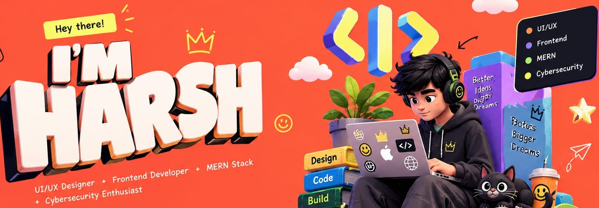

<!-- ===================== HEADER ===================== -->

<!-- BIG HERO IMAGE -->

  

  

<!-- STATUS BAR -->

  

<!-- SOCIALS -->

 

---

## ⚡ About Me

> **"I learn best by building, experimenting and continuously improving."**

I'm a **B.Tech AIML student** and **MERN stack developer** passionate about **Artificial Intelligence**, **Web Development**, **UI/UX Design**, **3D Design** and **Cybersecurity**.

I turn ideas into practical digital experiences: modern web apps, AI experiments, clean interfaces, 3D scenes in Blender, and security exploration.

---

## 🧩 What I Do

<table>
<tr>
<td width="50%" valign="top">

### 🤖 AI & Machine Learning
- AI / ML fundamentals
- Computer Vision & Generative AI
- Practical projects with **YOLO**

</td>
<td width="50%" valign="top">

### 🌐 Web Development
- MERN stack applications
- Responsive, interactive interfaces
- Clean, maintainable code

</td>
</tr>
<tr>
<td width="50%" valign="top">

### 🎨 UI/UX Design
- Clear visual hierarchy
- Usability-first interaction design
- Ideas → polished interfaces

</td>
<td width="50%" valign="top">

### 🧊 3D Design
- Models & environments in **Blender**
- Materials, lighting, rendering
- Product visualization & stylized art

</td>
</tr>
<tr>
<td colspan="2" valign="top">

### 🔐 Cybersecurity
Networking fundamentals · Ethical hacking · Vulnerability assessment · Responsible testing

</td>
</tr>
</table>

---

## 🛠️ Tech Arsenal

  

  

---

## 🎯 Currently Exploring

| | Focus |
|:--|:--|
| 🤖 **AI / ML** | Computer Vision, Generative AI |
| ⚛️ **Frontend** | React & modern UI engineering |
| 🎨 **Design** | UI/UX principles, design systems |
| 🧊 **3D** | Blender lighting, materials, rendering |
| 🔐 **Security** | Vulnerability assessment, ethical hacking |

---

## 📊 GitHub Stats

 

---

## 🚀 Interests

`AI & Emerging Tech` · `Web & Frontend` · `UI/UX` · `3D & Blender` · `Cybersecurity` · `Creative Tech` · `Gaming` · `Continuous Learning`

---

### `Learn` → `Experiment` → `Build` → `Improve`

*Thanks for visiting. Let's build something amazing.* 🚀

